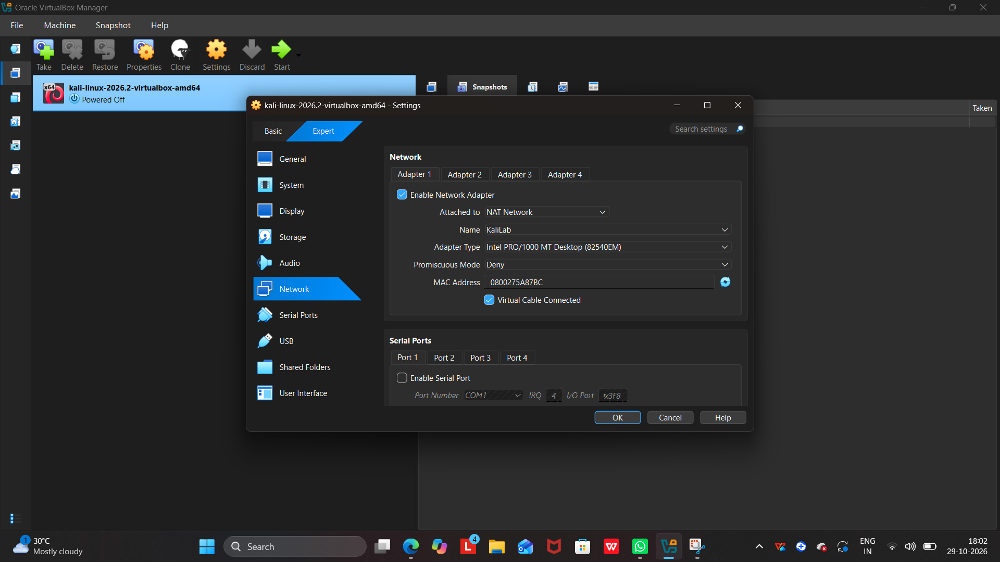
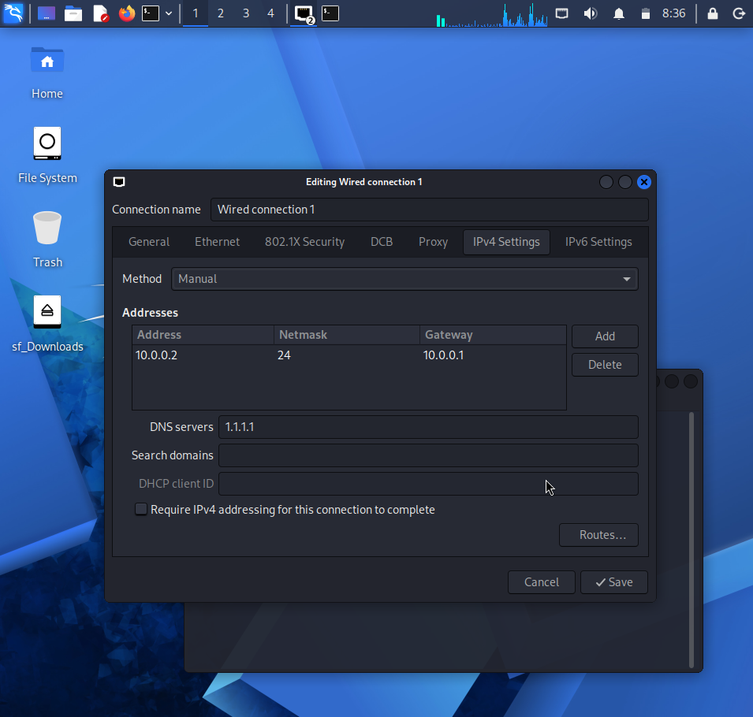

# Week 1 – Project Module 1
## Cybersecurity Lab Setup: VirtualBox and Kali Linux

### 1. Project Overview

The objective of this project is to configure a basic cybersecurity lab using Oracle VirtualBox and Kali Linux. The lab provides an environment for learning networking and cybersecurity fundamentals.

### 2. Tools Used

- Oracle VirtualBox
- Kali Linux
- NetworkManager
- Linux terminal

### 3. VirtualBox NAT Network Configuration

I created a NAT Network named `KaliLab` for the lab environment.

| Setting | Value |
|---|---|
| Network Name | KaliLab |
| IPv4 Prefix | `10.0.0.0/24` |
| DHCP | Disabled |
| IPv6 | Disabled |

**Screenshot 1: VirtualBox NAT Network details**

### 4. Kali Linux Network Configuration

I configured the Kali Linux virtual machine to use the NAT Network. I set the IPv4 connection manually to use the required lab IP address.

| Setting | Value |
|---|---|
| IPv4 Method | Manual |
| IP Address | `10.0.0.2` |
| Netmask | `255.255.255.0` |
| Gateway | `10.0.0.1` |

**Screenshot 2: Kali Linux Edit Connection settings**

### 5. Network Verification

I used the following commands to inspect the network configuration and test connectivity.

Check IP address:

`ip -br addr`

Check routing table:

`ip route`

Test DNS and network connectivity:

`ping -c 4 google.com`

The intended Kali IP address is `10.0.0.2/24`. Network connectivity should be verified using the command results.

### 6. Conclusion

This project documents the initial setup of a Kali Linux cybersecurity lab using VirtualBox. The NAT Network and Kali Linux IPv4 settings are documented with screenshots for reference.
